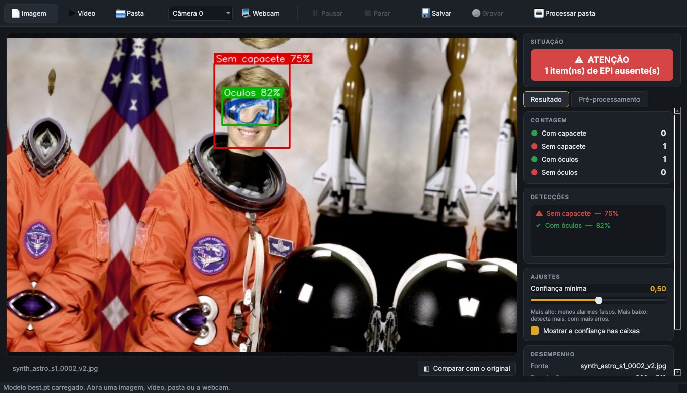
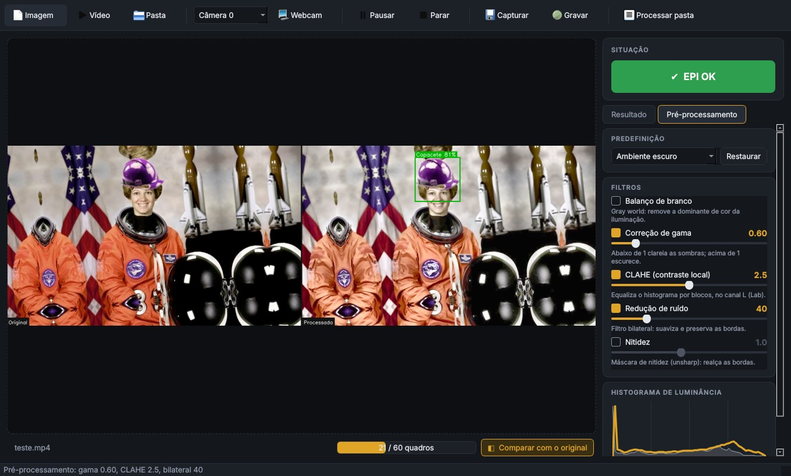

# EPI Detector — Detecção de Capacete e Óculos de Proteção

Trabalho prático da disciplina **CCC309 – Processamento de Imagens e Visão Computacional** (UPF, 2026/2).

Aplicação desktop que verifica, em imagens, vídeos ou pela webcam, se as pessoas estão usando **capacete** e **óculos de proteção**. Cada EPI presente é marcado em verde, cada EPI ausente em vermelho, e uma faixa de situação indica se está tudo certo ou quantos itens faltam. Útil para fiscalização de segurança em obras, laboratórios e oficinas.

> 🎬 **Vídeo demonstrativo:** 

**Equipe:** Emerson Rosado Scalcon · Leandro Trevisan Martins



---

## Funcionalidades

- **Entradas:** imagem, vídeo, pasta de imagens (navegação com ← →) ou webcam — pelos botões ou **arrastando arquivos/pastas para a janela**. Formatos: JPG, PNG, BMP, TIFF, WEBP; MP4, AVI, MOV, MKV, WMV. Caminhos com acento funcionam no Windows.
- **Resultado:** situação (EPI OK / atenção / nenhuma pessoa), contagem por classe, lista de detecções com a confiança, e desempenho (tempo de pré-processamento, de inferência e quadros/s).
- **Confiança mínima ajustável**, com reprocessamento imediato da imagem.
- **Pré-processamento** com cinco filtros de PDI, predefinições, comparação lado a lado com o original e histograma de luminância (detalhes abaixo).
- **Saídas** (em `results/`): salvar a imagem anotada, capturar quadro e **gravar o vídeo anotado** durante vídeo/webcam, e **Processar pasta**, que anota todas as imagens de uma pasta e gera `relatorio_epi.csv` (status de cada imagem, contagens e filtros usados).

## Como executar

Requisitos: Python 3.10+ (testado no Windows e no Linux). Não precisa de GPU.

```bash
git clone https://github.com/emersonscc/detector-EPI.git
cd detector-EPI
python -m venv .venv
.venv\Scripts\activate        # Linux/macOS: source .venv/bin/activate
pip install -r requirements.txt
python app.py
```

O modelo treinado (`models/best.pt`, 5 MB) já está no repositório.

Também há uma versão em linha de comando:
```bash
python -m src.main --image foto.jpg --save
python -m src.main --video obra.mp4
python -m src.main --webcam
```
Opções: `--conf` ajusta a confiança mínima (padrão 0,5); `--weights caminho.pt` usa outros pesos.

## Como funciona

```
entrada (imagem / vídeo / webcam)
   → pré-processamento (opcional: balanço de branco, gama, CLAHE, bilateral, nitidez)
   → detecção com YOLO26n (4 classes)
   → anotação (caixas, rótulos, faixa de status) e painel de resultados
```

O detector é um **YOLO26n** (Ultralytics) ajustado por *transfer learning* a partir dos pesos pré-treinados no COCO. Ele localiza e classifica quatro classes:

| Classe | Significado | Cor |
|---|---|---|
| `helmet` | capacete presente | verde |
| `no_helmet` | cabeça sem capacete | vermelho |
| `goggles` | óculos de proteção presente | verde |
| `no_goggles` | rosto sem óculos de proteção | vermelho |

## Técnicas de processamento de imagens

### Na aplicação: pré-processamento (`src/preprocess.py`)

Filtros opcionais aplicados antes da detecção, todos com OpenCV, na ordem abaixo:

| Técnica | Como funciona | Quando ajuda |
|---|---|---|
| Balanço de branco (*gray world*) | escala cada canal para igualar as médias de B, G e R (tabela de consulta por canal) | luz amarelada ou azulada |
| Correção de gama | `saída = 255·(entrada/255)^γ` por tabela de consulta (LUT) | imagem escura (γ < 1) ou estourada (γ > 1) |
| CLAHE | equalização adaptativa de histograma por blocos, com limite de contraste, só no canal L do espaço Lab | contraluz, pouco contraste local |
| Filtro bilateral | média ponderada pela distância espacial **e** pela diferença de intensidade: suaviza sem borrar bordas | sensor ruidoso, pouca luz |
| Máscara de nitidez (*unsharp*) | `img + k·(img − GaussianBlur(img))` | foco suave, compressão de vídeo |

Cor e brilho vêm primeiro, depois contraste, depois ruído; a nitidez fica por último para não realçar o ruído. Em 1280×720, numa CPU comum: CLAHE ≈ 7 ms, bilateral ≈ 25 ms, gama e balanço de branco < 3 ms — dá para usar em tempo real.

A interface tem predefinições (*Ambiente escuro*, *Contraluz*, *Câmera ruidosa*, *Luz artificial*), o botão **Comparar com o original** e o histograma de luminância antes/depois:



Os filtros nem sempre melhoram a detecção: o modelo foi treinado com imagens sem filtro, então um realce forte pode tirar a imagem do padrão que ele conhece. Por isso cada filtro é opcional e o efeito pode ser comparado ao vivo.

### Na preparação dos dados (`scripts/`)

- **Recorte dos EPIs** (`prepare_cutouts.py`): remove o fundo de fotos de capacetes e óculos e gera PNGs com transparência. O fundo xadrez de "transparência falsa" é separado por **análise de textura** (desvio padrão local); fundos lisos por **preenchimento a partir das bordas** no espaço Lab; depois **componentes conexos** e **morfologia** (abertura/fechamento) limpam a máscara, e as lentes ficam semitransparentes.
- **Geração de dados sintéticos** (`synth_dataset.py`): detecta rosto e olhos com **classificadores Haar**, encaixa capacete e óculos por **transformação afim** (escala, rotação pela inclinação da cabeça), **harmoniza cor e brilho** com a cena e compõe por **alpha blending**. Os rótulos YOLO saem automaticamente.
- **Captura** (`capture_webcam.py`): descarta quadros quase iguais comparando versões reduzidas em escala de cinza.

## Modelo e treinamento

### Dados
1. **[PPEs — Roboflow Universe](https://universe.roboflow.com/ramcomills/ppes-kaxsi-v4bep)** (licença CC BY 4.0): mantidas só as 4 classes de interesse, ~15,8 mil imagens.
2. **Sintético próprio**: 2.092 imagens geradas a partir de vídeos da webcam de duas pessoas sem EPI, com capacetes e óculos colados nas 4 combinações. Cobre o cenário que o dataset público não tem: pessoa de frente para a câmera, de perto.

### Divisão sem vazamento (`scripts/filter_dataset.py`)
O dataset público tem muitos **quadros consecutivos de vídeo**, quase idênticos. Dividir imagem por imagem coloca quadros vizinhos no treino e no teste e infla as métricas. Por isso:
- quadros de um mesmo vídeo são agrupados em blocos de 100, e cópias aumentadas da mesma foto ficam juntas; cada grupo vai inteiro para um único conjunto;
- os grupos são distribuídos por **estratificação iterativa**, equilibrando as 4 classes ao mesmo tempo em 70/20/10;
- as imagens sintéticas são divididas **por pessoa/sessão** (uma pessoa inteira fica só na validação) e **nunca entram no teste**, que mede apenas imagens reais.

Resultado: 12.489 imagens de treino, 3.814 de validação e 1.577 de teste.

### Treino
Google Colab (GPU T4), 50 épocas, imagens 640×640, *batch* 16, *early stopping* com paciência 15; o melhor modelo foi o da época 36 (~3,6 h). Para reproduzir:

```bash
python scripts/filter_dataset.py --src data/raw/ppes --dst data/processed/epi --sinteticas data/synthetic
```
Compacte `data/processed/epi`, envie o zip para o Google Drive e execute `notebooks/treino_colab.ipynb`. O notebook treina, avalia no conjunto de teste e salva tudo no Drive (retomando o treino se a sessão cair).

## Resultados

Métricas no **conjunto de teste** (1.577 imagens reais nunca vistas no treino):

| Classe | Precisão | Recall | mAP50 | mAP50-95 |
|---|---|---|---|---|
| helmet | 0,931 | 0,922 | 0,961 | 0,600 |
| no_helmet | 0,865 | 0,858 | 0,924 | 0,425 |
| goggles | 0,843 | 0,951 | 0,964 | 0,563 |
| no_goggles | 0,807 | 0,904 | 0,937 | 0,537 |
| **todas** | **0,861** | **0,909** | **0,946** | **0,531** |

Inferência: 2,6 ms por imagem na GPU T4 e cerca de 65 ms em CPU (≈ 15 quadros/s), sem GPU.

**Comparação entre os treinos**

| | Treino v1 | Treino v2 (atual) |
|---|---|---|
| Dados | só Roboflow, divisão imagem a imagem | Roboflow + sintético, divisão por grupos e estratificada |
| mAP50 / mAP50-95 | 0,968 / 0,575 (validação com vazamento) | 0,946 / 0,531 (teste sem vazamento) |
| Webcam (uso real) | marcava capacete em quem não usava; não detectava óculos | responde corretamente às 4 combinações, com poucos erros |

As métricas do v1 pareciam melhores, mas eram infladas por quadros quase idênticos nos dois lados da divisão; o v2 mede de forma honesta e, principalmente, funciona no cenário real da webcam graças aos dados sintéticos. Gráficos completos (curvas, matrizes de confusão, exemplos) em [`docs/treino_v1`](docs/treino_v1) e [`docs/treino_v2`](docs/treino_v2).

### Limitações
- A classe `no_helmet` é a de enquadramento menos preciso (mAP50-95 0,425): o limite de uma cabeça sem capacete é mais ambíguo que o contorno de um capacete.
- O desempenho na webcam foi avaliado de forma qualitativa; um conjunto de teste com fotos reais anotadas daria esse número.
- Óculos comuns (de grau ou de sol) podem ser confundidos com óculos de proteção.
- Os dados sintéticos vêm de poucas pessoas; mais variedade de rostos, ambientes e modelos de EPI melhoraria a generalização.

## Estrutura do repositório
```
├── app.py                  # abre a interface gráfica
├── src/
│   ├── gui/                # interface gráfica (PySide6)
│   │   ├── main_window.py  # janela principal
│   │   ├── preprocess_panel.py  # aba de pré-processamento
│   │   ├── workers.py      # vídeo/webcam e lote em threads
│   │   ├── widgets.py      # componentes visuais
│   │   └── styles.py       # tema
│   ├── detector.py         # wrapper do modelo YOLO
│   ├── pipeline.py         # pré-processamento → detecção → desenho
│   ├── preprocess.py       # filtros de PDI
│   ├── utils/drawing.py    # caixas, rótulos e faixa de status
│   ├── utils/io.py         # leitura/gravação de imagens
│   └── main.py             # versão em linha de comando
├── scripts/
│   ├── filter_dataset.py   # filtragem, reindexação e divisão sem vazamento
│   ├── prepare_cutouts.py  # recorte dos EPIs (fundo → transparência)
│   ├── capture_webcam.py   # captura de fotos pela webcam
│   └── synth_dataset.py    # geração do dataset sintético
├── notebooks/
│   └── treino_colab.ipynb  # treino no Google Colab
├── models/best.pt          # modelo treinado (v2)
├── docs/                   # resultados dos treinos e imagens do README
├── data/                   # datasets (não versionados)
└── results/                # saídas da aplicação (não versionadas)
```

## Tecnologias e créditos
Python, OpenCV, Ultralytics YOLO26, PyTorch, PySide6 (Qt).
Dataset público: *PPEs* por ramcomills, Roboflow Universe, licença CC BY 4.0.
